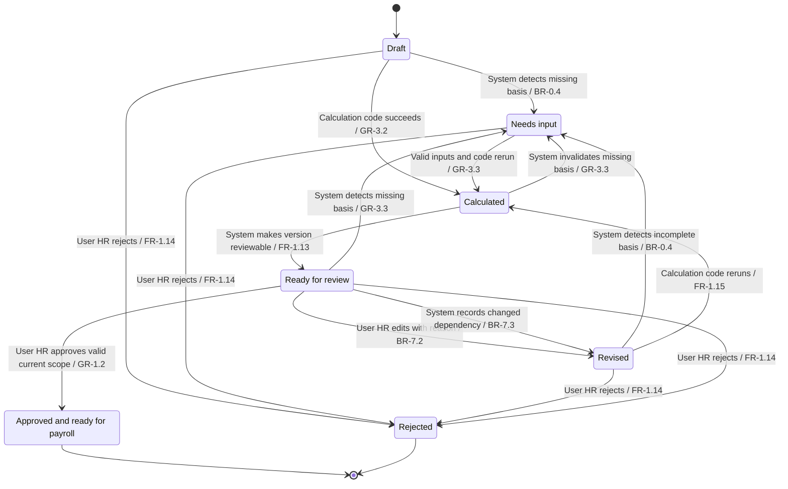

# HCM One: Edge Cases and States

Sources: [user flows](user-flows.md), [BRD v1.1](../../input/requirements/Payroll_brd_v1.1.md), the approved [brief gaps](../01-project/project-brief.md), [strategy](../04-strategy/mvp-scope.md), [UX principles](../04-strategy/ux-principles.md) and [decision log](../../project-memory/design-decisions.md). BRD v1.1 is the only BRD used. This document specifies logical states, not visuals or AI response copy.

## 1. Summary
HR proposals require valid inputs, deterministic calculations and explicit approval. Settlement components retain separate bases, due-date bases, statuses and permitted hold reasons inside one reconciled summary. Query states reflect recorded employee or HR actions, not assumed completion or a promised response time. (FR-1.12–FR-1.17, FR-2.13–FR-2.19, FR-3.5, FR-3.14–FR-3.21, FR-6.7–FR-6.13; GR-1.1–GR-1.3)

**Known — High for explicit requirements:** The BRD specifies guards, outcomes, missing-data behavior and query status names. **Recommended — Proposed. Project owner decides:** Exact intermediate state names, transition triggers, approval-version checks, component approval scope, query routing and matching, retries and GAP-04 details are architecture proposals. Recommended handling is not an invented research finding. All 13 scenarios below are mapped, not executed or claimed to pass.

## 2. HR proposal states and transitions

Apply this contract to hike and bonus proposals and to the explicitly valid review scope of settlement. A group or settlement summary can retain incomplete scope even when a subset has approved records. A missing amount is never zero, and an unresolved tax dependency cannot be hidden in an approved net. (FR-2.16–FR-2.18, FR-3.14, FR-3.17–FR-3.20; GR-3.3)

| State | Meaning | Allowed next states and triggering actor | Source and handling |
|---|---|---|---|
| Draft | Request exists; scope has not yet produced a valid calculation. | System validates supplied details: Needs input or Calculated after Calculation code succeeds. User: HR Admin can reject the request. | FR-1.2–FR-1.4, FR-2.3, FR-3.3; exact name Recommended |
| Needs input | A required record, value, rule or decision basis is missing or unusable. | User: HR Admin supplies request details, or System obtains authoritative records and verified config; Calculation code reruns to Calculated. User: HR Admin may reject. No approval transition. | FR-1.12, FR-2.13, FR-3.5, FR-3.17; BR-0.4; known block, Recommended name |
| Calculated | Code has a valid scoped result and traceable inputs; no approval exists. | System exposes the valid version for review: Ready for review. Invalidated data or rule basis: Needs input. | FR-1.10–FR-1.13, FR-2.12–FR-2.15, FR-3.15–FR-3.18; GR-3.2–GR-3.5; Recommended transition |
| Ready for review | Current valid calculation and relevant sources are available for HR. | User: HR Admin explicitly approves: Approved and ready for payroll after System validates the scope. User edits with reason: Revised. User rejects: Rejected. System detects missing or changed basis: Needs input or Revised. Silence stays here. | FR-1.14–FR-1.16, FR-2.16–FR-2.18, FR-3.19; BR-7.1–BR-7.3; GR-1.2 |
| Revised | A new version records an edit or changed dependency. Previous approval does not transfer automatically. | Calculation code reruns: Calculated; incomplete basis: Needs input. User: HR Admin may reject the new version. Fresh review is required. | FR-1.15, FR-2.17, FR-3.19; BR-7.2–BR-7.3; Recommended version contract |
| Approved and ready for payroll | Explicit HR approval belongs to this valid version and scope. It records requester, approver and time; it never means paid. | No automatic apply or payment. This approval snapshot ends its version path. A later change creates a separate new version requiring calculation and review; the old approval is preserved historically. | FR-1.16–FR-1.17, FR-2.18–FR-2.19, FR-3.18–FR-3.21; GR-1.1; GAP-06 proposal |
| Rejected | HR rejected the proposal or scoped entries, with an audit record. | No release or payment. A later request starts a separate Draft rather than silently changing the rejected version. | FR-1.14, FR-2.16, FR-3.19; GR-7.1; Recommended restart contract |

**Normal order:** Draft → Calculated → Ready for review → Approved and ready for payroll. Needs input is a blocking branch; Revised returns through calculation and review; Rejected is a user-selected end. No AI action reaches an approval state. (GR-1.1–GR-1.2; BR-7.1)



The diagram describes one version's lifecycle. Recalculation failure is a system overlay, not a state that permits approval. New versions after a completed snapshot are linked records, not edits to the historical approval. Bonus and settlement use their corresponding approval requirements in the table. (FR-2.16–FR-2.19, FR-3.19–FR-3.21; BR-7.3)

## 3. Settlement component states (Option B)

**Known — High:** Component-level bases, applicable due dates, preparation and approval statuses and reasons are required by BRD v1.1 and approved DEC-008. The following exact record contract and phase labels are Recommended. (FR-3.5, FR-3.14–FR-3.20; BRD 7, 9.5, 9.8)

| Component field | Required logical meaning | Source |
|---|---|---|
| Identity and scope | Employee, component type and proposal version; no unrelated employee data. | FR-3.2, FR-3.6–FR-3.12; GR-2.3–GR-2.5 |
| Calculation basis | Recorded input IDs, formula, company setting and rule version and source. | FR-3.15; BR-0.1–BR-0.4; GR-3.5 |
| Classification | Verified component category used to select the applicable rules; unknown remains unknown. | FR-3.5, FR-3.14; BRD 7, 9.5, 9.8; GR-3.1 |
| Due-date basis | Verified rule source and effective date, recorded trigger date and required calendar basis. Calculation code derives a due date only if this basis is complete. No universal deadline is filled in. | FR-3.14, FR-3.18; BR-0.1–BR-0.4; GR-3.2 |
| Amount and totals scope | Code-derived payable or recoverable amount, rounding basis and whether it belongs to a complete total or an explicitly incomplete subtotal. Unknown is not zero. | FR-3.6–FR-3.14; BR-0.3; GR-3.3 |
| Preparation phase | Draft, Needs input, Calculated, Ready for review, Revised, Held or Not applicable as defined below. | FR-3.5, FR-3.14, FR-3.16–FR-3.18 |
| Approval status | Not approved, Approved or Rejected, attached to an explicit version and scope; only User: HR Admin can approve or reject. | FR-3.19–FR-3.21; BR-7.1–BR-7.3 |
| Hold reason and basis | Recorded clearance dependency and verified rule permitting that hold on this component; no unrelated blanket hold. Missing permission creates Needs input. | FR-3.4–FR-3.5; GR-3.1–GR-3.3 |

| Component condition or state | Allowed transition and actor | Source and handling |
|---|---|---|
| Draft → Needs input | System finds an unknown amount, classification, due-date trigger or rule; only that affected part stops. | Known block: FR-3.5, FR-3.17; Recommended phase names |
| Draft or Needs input → Calculated | Valid basis becomes available and Calculation code succeeds. No approval is inferred. | GR-3.2–GR-3.3; FR-3.15 |
| Calculated → Ready for review | System identifies a complete review scope including any dependent TDS or summary amounts. | FR-3.13–FR-3.19; Recommended scope checks |
| Calculated or Ready for review → Held | System records a pending clearance and a verified rule permitting this component's hold. Amount and reason remain visible; approval status stays explicit. | FR-3.4–FR-3.5, FR-3.20; Known hold limit |
| Held → Revised → Calculated → Ready for review | System records confirmed release of the specific dependency; Calculation code rechecks basis, dates, amounts and dependent totals; HR reviews the new release version. Clearance alone is not approval or payment. | FR-3.5, FR-3.19–FR-3.21; BR-7.3; Recommended GAP-04 release sequence |
| Ready for review → Approved and ready for payroll | User: HR Admin explicitly approves; System validates scope and stores its version and time. No unresolved dependent amount enters an approved final net. | FR-3.14, FR-3.19–FR-3.21; GR-1.1–GR-1.2; Recommended readiness label |
| Ready for review → Revised | User: HR Admin edits with a reason; System versions the change; Calculation code reruns all affected amounts and dependencies. | FR-3.19; BR-7.2–BR-7.3 |
| Draft, Needs input, Revised or Ready for review → Rejected | User: HR Admin rejects that review scope; System records it. | FR-3.19, FR-3.21; Recommended explicit scope |
| Verified ineligibility → Not applicable | Calculation code establishes a component does not apply under a complete verified rule; retain reason and source. This is not a guessed zero or approval. | FR-3.8, FR-3.16; BR-6.3; Recommended phase name |

**Summary rules:** A fully known calculation can have a complete contract net while a known permitted held component is not ready for release. Show its status separately. If an amount or dependent tax basis is unknown, the final net remains incomplete; only explicitly scoped calculated subtotals are available. Recommended: a confirmed component can be approved separately only when its dependencies are fully known, and the statement preserves all unresolved or held components and the scope of approval. An aggregate approved scope is not a claim that all components are complete. (FR-3.14, FR-3.17–FR-3.20; GR-3.3; AS-14)

**Due dates:** A verified trigger change requires a recorded recalculation and review of affected scope. An unknown trigger never becomes a fabricated date, and an overdue recorded date does not authorize System payment or a legal conclusion. No deadline value is configured by this document. (BR-0.1–BR-0.4; GR-1.1, GR-3.1, GR-4.1)

## 4. Query states and transitions

Status names Sent, In review, Resolved and Closed are known from FR-6.11. Draft supports the required review and confirmation before sending. Exact routing, append, closure and reopen triggers are Recommended under GAP-07. All reads and transitions recheck identity and record access. (FR-6.6–FR-6.13; GR-1.3, GR-2.1–GR-2.5)

| From | Triggering actor and action | To | Guard and requirement source |
|---|---|---|---|
| No persisted query | AI agent prepares a factual draft; System keeps it unsubmitted. | Draft | Only relevant own data; no invented evidence. FR-6.4–FR-6.5; GR-3.1 |
| Draft | User: Employee edits description or removes an attachment. | Draft | Previous confirmation is cleared if content changes. FR-6.6–FR-6.7; Recommended confirmation binding |
| Draft | User: Employee declines sending or accepts the explanation. | Draft or session ends unsent | No send, no resolution claim and no automatic HR message. FR-6.3, FR-6.7; GR-1.3 |
| Draft | User: Employee confirms current content and new-query choice; System successfully persists and delivers to authorized HR. | Sent | ID and next step returned only after success. FR-6.7, FR-6.9, FR-6.12; Recommended delivery definition |
| Draft adding to an existing open query | User: Employee confirms an append; System records it under the selected own-query ID. | Existing Sent or In review retained | Preserve history and ID; no automatic merge or new duplicate. FR-6.8, FR-6.10–FR-6.13; Recommended append contract |
| Sent | User: authorized HR Admin explicitly takes review. | In review | Role and employee scope checked. FR-6.11–FR-6.12; GR-2.3; Recommended trigger |
| In review | User: HR Admin adds a reply while the issue remains unresolved. | In review | Record reply; do not infer resolution from any reply. FR-6.11–FR-6.13; Recommended trigger |
| In review | User: HR Admin records a resolution and reply. | Resolved | Store resolution against ID; this is not approval to change payroll. FR-6.13; GR-1.2 |
| Resolved | User: Employee disputes the resolution; System records the action for authorized HR. | In review | Explicit dispute, no silent closure. FR-6.10–FR-6.13; Recommended reopen rule |
| Resolved | User: Employee acknowledges closure, or authorized HR explicitly closes after recorded resolution. | Closed | No automatic timer or silence rule. FR-6.11–FR-6.13; Recommended closure rule |
| Closed | User: Employee has a new or continuing issue. | Closed remains historical; new Draft under Flow 6 if requested | Do not overwrite history or automatically reopen a closed record. FR-6.1, FR-6.8, FR-6.13; Recommended treatment |

Delivery failure leaves Draft with an error, not Sent. A repeated confirmed submission must not create multiple query IDs or append the same content twice; a changed draft must be confirmed again. No response time is assumed. (FR-6.7–FR-6.9; GR-1.3, GR-4.3; Recommended retry contract)

```mermaid
stateDiagram-v2
    state "In review" as InReview
    [*] --> Draft
    Draft --> Draft: Employee edits; confirmation cleared / FR-6.6
    Draft --> Sent: Employee confirms and System delivers / FR-6.7 FR-6.9
    Draft --> Draft: Delivery fails; no send claimed / GR-1.3
    Sent --> Sent: Confirmed append to same open query / FR-6.8
    Sent --> InReview: Authorized HR takes review / FR-6.12
    InReview --> InReview: HR replies without resolution / FR-6.13
    InReview --> InReview: Confirmed append or HR continues / FR-6.8
    InReview --> Resolved: HR records resolution / FR-6.13
    Resolved --> InReview: Employee disputes resolution / FR-6.11
    Resolved --> Closed: Explicit closure after resolution / FR-6.11
    Closed --> [*]
```

The diagram represents one query ID. Adding to an open ID is a confirmed action from a separate draft, not a bypass of confirmation. Closed history is retained if a new issue starts another Draft. (FR-6.7–FR-6.8, FR-6.13)

## 5. System states per flow

These states overlay the flow or component lifecycle. They never grant approval. Recovery uses the listed authorized actor and returns to the relevant validation step. Exact state names and retry behavior are Recommended; the required privacy, missing-data and scope behavior is Known. (GR-1.1–GR-1.3, GR-2.1–GR-2.6, GR-3.1–GR-3.4, GR-4.1–GR-4.3)

| System state | Flow 1: hike | Flow 2: bonus | Flow 3: settlement | Flow 4: salary | Flow 5: TDS | Flow 6: query | Guard and recovery source |
|---|---|---|---|---|---|---|---|
| Loading | Retrieve historical inputs and rules. | Retrieve authorized group and policy inputs. | Retrieve component and exit bases. | Retrieve own comparison periods. | Retrieve own tax sources. | Retrieve own issue or status and authorized HR delivery context. | System performs reads; no final result yet. Return to the requesting step only after valid data arrives. GR-2.1–GR-2.5, GR-3.1 |
| Missing data | Needs input at F1-02, F1-06 or F1-08; no full total. | Affected employee Needs input at F2-03 through F2-06. | Affected component Needs input at F3-04 through F3-08; net incomplete if dependent. | Block unsupported comparison at F4-04 or F4-05; user may choose available periods or query. | Block unsupported tax computation at F5-03 through F5-05; offer query for unresolved issue. | Identify missing issue evidence at F6-04 without inventing it; employee may clarify or confirm actual available content. | HR supplies request detail, or System obtains authoritative records and verified config. Employee never edits payroll. FR-1.12, FR-2.13, FR-3.17, FR-4.15, FR-5.12, FR-6.4; GR-3.3 |
| Permission denied | Unauthorized HR cannot retrieve employee. | Unauthorized group entries reveal no data. | Unauthorized exit records unavailable. | Another employee's salary is never confirmed. | Another employee's tax is never confirmed. | Deny unsafe attachment, ID lookup, candidate query or HR access. | System denies before returning private records. Retry only through a valid authorized request, not by revealing whether a record exists. GR-2.1–GR-2.4 |
| Low confidence | Clarify request or flag disputed result before approval. | Clarify type, rule or unusual entry. | Flag ambiguous eligibility or unknown basis; do not invent hold permission. | Identify unexplained difference and offer Flow 6. | Identify unexplained TDS and offer Flow 6. | Draft only the factual unresolved issue; do not invent a cause. | HR reviews HR issues; Employee confirms any query sending. GR-3.4, GR-6.1–GR-6.2; FR-3.16; GR-1.3 |
| Calculation error | Keep failed version unapproved; rerun F1-06 through F1-08 after correction. | Block affected entries; rerun F2-04 through F2-06. | Block affected component and dependent totals; rerun F3-05 through F3-08. | Do not relay a fabricated difference; rerun F4-05 or offer query. | Do not relay guessed tax; rerun F5-04 through F5-05 or offer query. | If numeric checking fails at F6-03, preserve a factual query about the unresolved issue, not an invented computed value. | Calculation code reports failure; System retains the basis and version. No approval or automatic payroll update. GR-3.1–GR-3.3 |
| Out of scope request | No monthly payroll execution or payment. | No statutory-bonus or payment service. | No legal advice, payment execution or assumed hold entitlement. | No bank or Form 26AS integration or other-user data. | No personal regime or investment advice. | No non-payroll ticket or unrelated data disclosure. | Refuse the unsupported action; retain any valid payroll question separately. BR-5.5; GR-4.1–GR-4.3, GR-5.1–GR-5.3; BRD 5.3 |

A06-13 — **For Agent 06:** wording and confidence display for loading, missing data, low confidence, calculation failures, scope refusals and privacy refusals. No response copy, confidence scale or trust mechanism is designed here. (GR-3.4, GR-5.3, GR-6.1)

## 6. BRD test scenarios mapped

Scenario numbers and titles are copied from current BRD Section 9.10. Expected states are conditional on valid mock records and verified configured rules. This table is a coverage map, not a test execution report.

| Scenario | Flow | Path | Expected state | Requirement IDs |
|---|---|---|---|---|
| 1. Back-dated hike with LOP in one of the affected months | Flow 1 | F1-06 through F1-10; use each month's own paid days. | Calculated → Ready for review when all bases are valid; Approved and ready for payroll only after explicit HR action. | FR-1.5–FR-1.9, FR-1.14–FR-1.16; BR-1.1–BR-2.3 |
| 2. Back-dated hike crossing 17 September 2026, when the PF wage ceiling changed | Flow 1 | F1-06 through F1-08; inspect dated rule selection and GAP-02 split. The scenario title is BRD wording, not independent verification. | Needs input while verification or the split basis is missing. With an approved verified split rule: Calculated → Ready for review. Never silently select one ceiling for the entire month. | FR-1.7, FR-1.11–FR-1.12; BR-0.1–BR-0.4, BR-3.6–BR-3.7 |
| 3. Back-dated hike where one month's attendance is missing | Flow 1 | F1-06 missing-record branch; do not substitute zero LOP. | Affected period Needs input; proposal has no complete total or approval. Valid source recovery returns through calculation. | FR-1.5, FR-1.12; GR-3.3 |
| 4. Bonus for a team with one mid-year joiner and one employee on notice period | Flow 2 | F2-04 eligibility and F2-05 proration under the specific configured company criteria. | Each known eligible entry Calculated → Ready for review; configured ineligible entry has a recorded reason. Unknown notice policy stays Needs input. | FR-2.4–FR-2.8; BR-5.1–BR-5.3 |
| 5. Bonus where one employee's performance data is missing | Flow 2 | F2-03 through F2-06 affected-entry block. | Missing employee Needs input, not zero achievement. Other fully valid entries can be reviewed; only explicitly approved valid entries become ready. | FR-2.13, FR-2.16–FR-2.18; GR-3.3 |
| 6. Full and final settlement for an employee eligible for gratuity | Flow 3 | F3-04, F3-06 and F3-08 through F3-12; verified eligibility and formula. | Gratuity Calculated → Ready for review; scope Approved only by HR. Missing service or rule basis instead remains Needs input. | FR-3.8, FR-3.15–FR-3.21; BR-6.3–BR-6.4 |
| 7. Full and final settlement for an employee just below gratuity eligibility | Flow 3 | F3-06 configured eligibility branch; flag any ambiguity. | Not applicable only when verified rule and service basis clearly establish ineligibility. Ambiguity remains Needs input and HR review, not a guessed entitlement or denial. | FR-3.8, FR-3.16–FR-3.17; BR-6.3 |
| 8. Full and final settlement with a pending asset clearance and notice shortfall | Flow 3 | F3-04 component hold check and F3-07 recovery calculation; release uses F3-11 and GAP-04. | Asset component Held only if the recorded verified rule permits it; otherwise unknown basis Needs input. Notice component can be Calculated from its own complete terms. No blanket hold or automatic release approval. | FR-3.4–FR-3.5, FR-3.10, FR-3.12, FR-3.19; BR-6.5–BR-6.6 |
| 9. Employee whose salary dropped because of LOP | Flow 4; optional Flow 6 | F4-05 through F4-08 with sourced attendance and net differences; F4-10 if disputed. | Explained with known recorded reasons; query Draft only if Employee requests it. | FR-4.4–FR-4.6, FR-4.12, FR-4.15; BR-1.1–BR-1.2 |
| 10. Employee whose TDS increased because declarations were not submitted | Flow 5; optional Flow 6 | F5-03 through F5-08 with recorded declaration status. | Explained if inputs and tax basis support the reason; missing computation basis stays blocked and can enter query Draft. | FR-5.5, FR-5.7–FR-5.10, FR-5.12; BR-4.4 |
| 11. Employee with no salary change between two months | Flow 4 | F4-05 and F4-06 no-component-change branch. | No component change identified. Do not invent a reason; net and deductions are still checked separately. | FR-4.8–FR-4.9; GR-3.1 |
| 12. An employee trying to see another employee's salary | Flow 4; same guard applies to all Employee flows | F4-01 before private-record retrieval. | Permission denied; no salary, identifiers or confirmation that another person's record exists. | FR-4.3, FR-4.17; GR-2.1–GR-2.4 |
| 13. An unresolved settlement component alongside a confirmed component. | Flow 3 | F3-04 through F3-09; known and unknown scopes remain distinct. | Unknown component Needs input; confirmed component Calculated or Ready for review if dependencies are complete. Overall settlement remains incomplete where net or tax depends on the unknown. No guessed complete net or assumed whole-settlement approval. | FR-3.5, FR-3.14, FR-3.17–FR-3.20; GR-3.3; BRD 9.10 |

## 7. Additional edge cases

These 18 cases are requirement-derived risks or recommendations, not newly observed user findings. Known handling has High confidence as explicit BRD behavior; Recommended handling is a proposal with Low confidence about target-user suitability unless a source says otherwise. No new flow is added.

| Case | Expected handling | Known or recommended | Source |
|---|---|---|---|
| EC-01: HR requests a group containing employees outside their authority. | Do not return private data for unauthorized members. Recommend keeping the authorized scope explicit and requiring HR to confirm a valid group before computation. | Known denial; Recommended group recovery | GR-2.1, GR-2.3–GR-2.5; FR-2.1 |
| EC-02: A rule is missing, unverified or has no clear effective period. | Stop the affected part. Do not reuse a convenient rule or choose a rate; request a verified applicable basis. | Known | BR-0.1–BR-0.4; GR-3.1–GR-3.3 |
| EC-03: Hike date yields no processed affected month or inconsistent date inputs. | Flag the unusual request and keep Draft or Needs input. Recommend clarification rather than introducing future payroll processing or a guessed zero result. | Known unusual-data flag; Recommended no-period path | FR-1.2, FR-1.4, FR-1.12; BR-2.1 |
| EC-04: Records change after calculation or while approval is being submitted. | Reject stale approval, preserve history and create a revised valid basis for fresh review. Do not inherit approval. | Recommended version check | BR-7.1–BR-7.3; GR-1.2; FR-1.15 |
| EC-05: Approval is retried after a response failure. | Recommend one durable approval event for the same version and scope; no duplicate ready amount. A different scope needs explicit review. | Recommended retry handling | FR-1.16–FR-1.17, FR-2.18–FR-2.19; GR-7.1 |
| EC-06: Remaining tax is negative, no months remain, or arrears cross financial years. | Stop undefined computation until GAP-05 is resolved. Do not silently clamp, divide by zero or invent a refund. | Known missing-rule block; unresolved rule handling | BR-4.1–BR-4.3, BR-0.4; GR-3.3 |
| EC-07: All bonus employees are ineligible under the complete company rule. | Return the recorded eligibility reasons and no eligible amount. Do not create an approved payout from an empty eligible scope. | Known eligibility result; Recommended empty-scope handling | FR-2.4–FR-2.5, FR-2.11, FR-2.18; BR-5.2 |
| EC-08: Zero target, malformed performance value or undefined incentive slab. | Distinguish valid zero from missing data. Use an explicit rule if it handles that case; otherwise stop that employee's calculation. | Known no-guessing; Recommended input validation | FR-2.7–FR-2.8, FR-2.13; BR-5.1; BR-0.4 |
| EC-09: Unusual bonus result is edited without a reason. | Flag the result and require the edit reason before a new calculation version. No silent amount override or automatic approval. | Known | FR-2.14, FR-2.17; BR-7.2–BR-7.3 |
| EC-10: Notice waiver, asset permission or recorded recovery basis is missing. | Do not assume a waiver, a recoverable amount or a permitted hold. Stop the affected part until its recorded and configured basis is valid. | Known | FR-3.5, FR-3.10–FR-3.12, FR-3.17; BR-6.5–BR-6.6 |
| EC-11: Fully known settlement net is negative. | Show recoverable from the employee, not paid. Require normal HR review and approval; do not execute collection. | Known | BR-6.7; FR-3.14, FR-3.18–FR-3.20; GR-1.1 |
| EC-12: Final-month attendance gives only whole-month LOP, or LOP exceeds the eligible final period. | Do not guess which unpaid days precede the last working day. Recommend requiring scoped input and rejecting inconsistent values before the GAP-04 calculation. | Known missing-data block; Recommended final-period validation | FR-3.6, FR-3.17; BR-1.1–BR-1.2, BR-6.1 |
| EC-13: Query draft or attachments change after Employee confirmation. | Require fresh confirmation of the actual content before sending; never restore removed evidence silently. | Known control; Recommended confirmation binding | FR-6.5–FR-6.7; GR-1.3 |
| EC-14: Query persistence, recipient access or delivery fails, then sending is retried. | Keep Draft until successful authorized delivery. Recommend a stable submission reference so a retry cannot create duplicate IDs or duplicate appends. | Recommended delivery and retry handling | FR-6.7–FR-6.9, FR-6.12; GR-2.3, GR-7.1 |
| EC-15: Two own queries share category and months but describe different issues. | Present them only as candidates. Employee chooses add or new; no automatic merge. Test the matching criteria through AS-15. | Known Employee choice; Recommended candidate criteria | FR-6.8; GR-2.2; GAP-07 |
| EC-16: Employee disputes Resolved, or returns with an issue after Closed. | Recommend Resolved → In review on explicit dispute; preserve Closed history and use the existing new-query path for a new request. No silent overwrite or timer closure. | Recommended transition rules | FR-6.1, FR-6.10–FR-6.13; GR-7.1 |
| EC-17: Evidence removed from a query leaves limited context for HR. | Send only the content the Employee actually confirms. Identify missing context, do not fabricate or secretly reattach it. Whether the remaining evidence is enough belongs to GAP-08 testing. | Known content control; unresolved sufficiency | FR-6.4–FR-6.7; GR-2.5, GR-3.1 |
| EC-18: A correction is needed after an approved settlement statement. | Preserve the approved snapshot. Recommend a linked new version within the existing settlement request and review flow for affected scope, with fresh HR approval; exact correction ownership remains open. | Recommended versioned correction; unresolved ownership | FR-3.19–FR-3.21; BR-7.1–BR-7.3; GR-7.1 |

## 8. GAP-04 proposed resolution

**Proposed. Project owner decides.** The final month's day basis and release or reapproval of held components require a concrete rule contract. These recommendations do not fill missing company settings or authorize a hold. (BR-1.1–BR-1.2, BR-6.1; FR-3.5, FR-3.19–FR-3.20)

| Option | Final-month day basis | Held-component treatment and trade-offs |
|---|---|---|
| A. Use the shortened final employment period as the day divisor and reuse an earlier approval when clearance completes | Divide by the days in the shortened period. This changes the BR-1.2 calendar-month daily basis and needs a BRD rule change rather than silent implementation. | Reusing approval may fail to cover a changed component basis, due date, tax or net. It is simpler operationally but weakens the review of the current version. (BR-1.2, BR-7.1–BR-7.3) |
| B. Keep the full calendar-month divisor and use a scoped final employment period; require fresh review after release | Eligible calendar days run from the recorded employment start within that month, or the first day if employed earlier, through the last working day inclusive. Paid days equal those eligible days minus LOP recorded inside that period. Earned salary uses monthly salary multiplied by these paid days divided by the full calendar month's days. | Fits the monthly divisor in BR-1.2 while making the last-working-day limit explicit. Needs scoped attendance; whole-month LOP cannot be allocated by guess. Release creates a new review version, which takes another explicit approval action but protects the current basis. (BR-1.1–BR-1.2, BR-6.1; FR-3.6, FR-3.17, FR-3.19) |

**Recommend B:**
1. Calculation code validates the recorded final employment period and scoped LOP before using the calendar-month divisor. If dates, period-specific LOP or the agreed basis are absent, mark that component Needs input. Do not guess a daily attendance split or an unapproved rounding order. (FR-3.6, FR-3.17; BR-0.3–BR-0.4, BR-1.1–BR-1.2, BR-6.1)
2. System records verified clearance completion only for the related component. If a permitted hold can end, create Revised with the release basis and a new version; never turn a clearance event into approval. (FR-3.4–FR-3.5, FR-3.19–FR-3.21; GR-1.1–GR-1.2)
3. Calculation code rechecks that component, its due-date basis, dependent TDS and totals. User: HR Admin reviews and explicitly approves the affected current scope. Even if the amount is unchanged, recommend a fresh release approval because the allowed status and dependency basis changed. (FR-3.13–FR-3.20; BR-7.1–BR-7.3)
4. Preserve unchanged approved components and their historical approval references. A changed dependent summary cannot inherit an approval that covered different values or scope. Update the statement from the newly approved snapshot, with any remaining unresolved or permitted held lines still explicit. (FR-3.14, FR-3.20–FR-3.21; BR-7.3)

The recommendation concerns calculation and readiness only. It does not collect recoveries, release money, verify national law or add a separate post-payroll flow. A missing rule or unknown permitted hold remains before-build work. (GR-1.1, GR-3.1, GR-4.1; BRD 5.3)

## 9. Open questions
- **Low:** Project owner must approve GAP-04's inclusive period, scoped LOP and fresh release review rule. The current monthly attendance definition may need a clarified final-period basis; no input schema is edited here. (BRD 9.3; BR-1.1–BR-1.2, BR-6.1)
- **Low:** Rules-config gaps GAP-01, GAP-02, GAP-03 and GAP-05 remain unresolved. Scenario coverage does not validate the reported PF change, its mid-month split or current tax and gratuity values. (BR-0.1–BR-0.4, BR-3.7; FR-1.11)
- **Low:** Settlement classification, hold permissions, verified calendars and due-date triggers must exist before a component can use them. G04 approved Option B, not guessed values. (FR-3.5, FR-3.14; BRD 7, 9.5, 9.8; DEC-008, DEC-010)
- **Low:** HR ownership of post-approval corrections, component approval scopes and dependent summary reapproval remain recommendations for G05. A real employer workflow is not established by the approved desk evidence. (FR-3.19–FR-3.21; BR-7.3)
- **Low — AS-15:** Query candidates based on own category and month set may help Employee choice, but accuracy and usefulness need Agent 08 testing. The System contract does not establish a preference or response-time expectation. (FR-6.8–FR-6.13; GAP-07)
- **Low:** Existing AS-10 through AS-14 remain unvalidated. GAP-08 still owns test baselines and thresholds; this mapping is not a test result. ([Assumption register](../01-project/assumptions.md); BRD 10)
