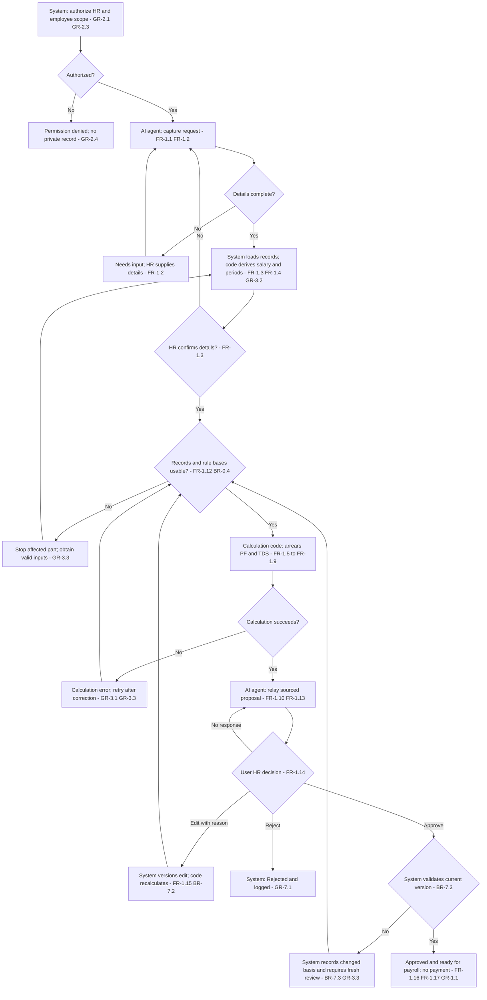
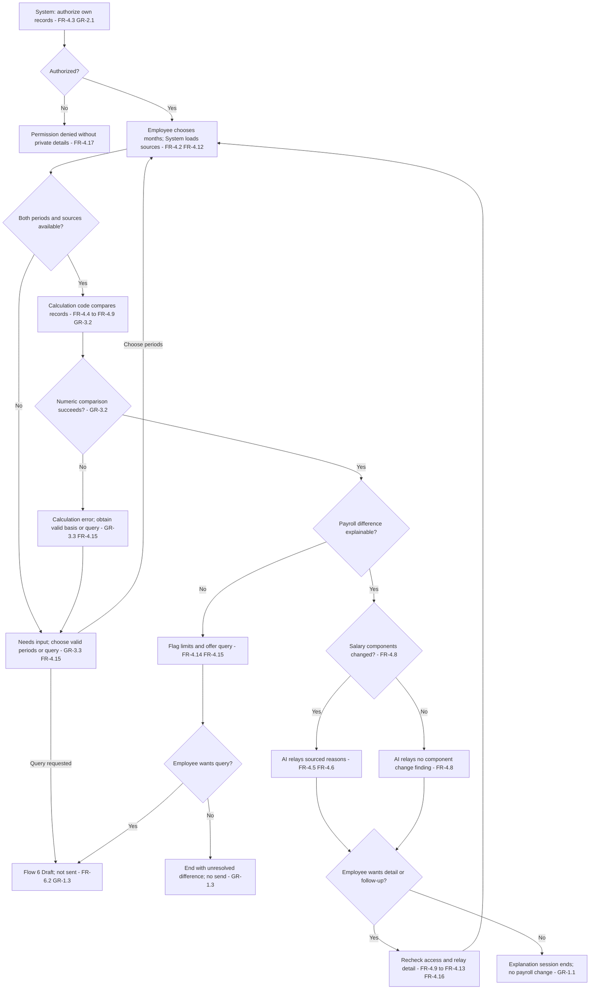
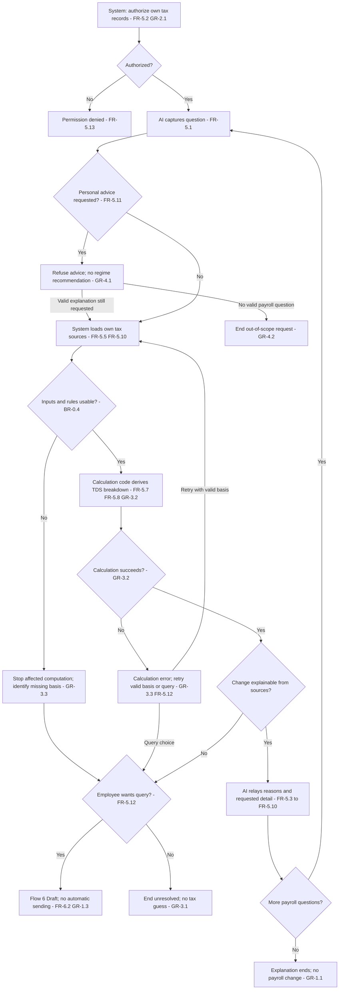
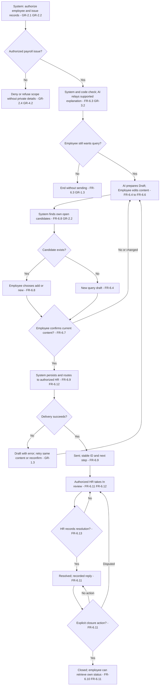

# HCM One: User Flows

Sources: [BRD v1.1](../../input/requirements/Payroll_brd_v1.1.md), the approved [problem statements](../04-strategy/problem-statements.md), [MVP scope](../04-strategy/mvp-scope.md), [UX principles](../04-strategy/ux-principles.md), [personas](../03-analysis/personas.md), [journeys](../03-analysis/journey-maps.md), [brief gaps](../01-project/project-brief.md) and [decisions](../../project-memory/design-decisions.md). The current BRD and approval records control where earlier strategy text still says Proposed. DEC-007, DEC-008, DEC-009 and DEC-010 are Approved. No historical BRD content is used as a requirements source.

## 1. Summary
Map all six existing flows. Hike, salary explanation, TDS explanation and query handling are priority 1; bonus follows, then settlement. The System checks access and stores records, Calculation code does all maths, and the AI agent explains traced results without approving, applying or paying anything. (BRD 5.2; GR-1.1–GR-1.3, GR-2.1–GR-2.6, GR-3.2)

**High for explicit requirements:** Requirement references below point to BRD v1.1. **Proposed. Project owner decides:** Exact state transitions, approval-version checks, query routing and matching, and GAP-04, GAP-06 and GAP-07 recommendations are architecture proposals where the BRD leaves details open. They do not establish measured user behavior. AS-10 through AS-14 remain unvalidated. No visual design or AI response copy is defined.

The state names in this file are defined in [edge cases and states](edge-cases-states.md). Loading and error states describe system work; they are not approval. A prepared amount never implies payment. A disputed result can enter Flow 6 only through an authorized Employee and their explicit confirmation; an HR error is flagged for authorized HR review, not sent as an employee query automatically. (FR-6.1–FR-6.7; GR-1.1–GR-1.3, GR-3.3–GR-3.4, GR-6.1–GR-6.2)

## 2. Actors and responsibilities

| Actor | Responsibility | Requirement source |
|---|---|---|
| User: HR Admin | Requests a proposal, confirms its scope, reviews source records, edits with a reason, approves the current version or rejects. Acts only for authorized employees. | FR-1.1–FR-1.3, FR-1.14–FR-1.17; FR-2.16–FR-2.19; FR-3.19; BR-7.1–BR-7.3; GR-2.3 |
| User: Employee | Requests their own explanation, selects periods, reviews or edits a query draft and explicitly confirms sending. Cannot edit payroll or approve a salary change. | FR-4.1–FR-4.3, FR-4.16–FR-4.17; FR-5.1–FR-5.2; FR-6.6–FR-6.11; GR-1.3, GR-2.2 |
| AI agent | Captures intent and missing request details, relays sourced calculation results and prepares explanation or query content. Does no arithmetic and has no approval authority. | FR-1.2, FR-2.2–FR-2.3, FR-3.3, FR-6.4; GR-1.1, GR-3.1–GR-3.5 |
| Calculation code | Determines periods, eligibility, proration, formula results, deductions, totals and numeric differences from authorized records and configured rules. Missing rules stop the affected part. | FR-1.4–FR-1.9, FR-2.4–FR-2.11, FR-3.6–FR-3.14; BR-0.1–BR-6.7; GR-3.2–GR-3.3 |
| System | Checks identity, role and record access; obtains permitted records; validates state changes; stores versions, approvals, query records and masked audit events. No payroll or payment execution is in scope. | FR-1.16–FR-1.17, FR-2.18–FR-2.19, FR-3.21, FR-6.9–FR-6.13; GR-2.1–GR-2.6, GR-7.1–GR-8.1 |

Shared checks run before every read or write, including attachments and follow-up questions. Out-of-scope requests and attempts to change guardrails are refused without revealing protected records or instructions. No API key appears in client data or logs. (GR-2.1, GR-4.1–GR-4.3, GR-5.1–GR-5.4, GR-7.2)

## 3. Flow 1 to Flow 6

### Flow 1: Back-dated salary hike — priority 1

**Trigger and actor:** User: HR Admin requests a hike for an employee and effective date. (FR-1.1)

**Preconditions:** Authorized HR identity; an identifiable employee, change amount and date; relevant salary, processed payroll, attendance and dated rule records. Required records may be missing, in which case the request can remain Draft or Needs input but cannot yield a complete proposal. (FR-1.2–FR-1.4, FR-1.12; BR-0.1–BR-0.4; GR-2.1, GR-2.3)

**Main path**

| Step | Actor | Action and result | Requirement source |
|---|---|---|---|
| F1-01 | System | Check identity, HR role and employee authorization before retrieving records. Denial ends the attempt without confirming private records. | GR-2.1, GR-2.3–GR-2.4 |
| F1-02 | AI agent | Capture employee, hike amount and effective date. Ask for missing request details; keep Draft or Needs input until supplied. | FR-1.1–FR-1.2; GR-3.1 |
| F1-03 | System | Load authorized salary structure, history, attendance and processed payroll periods, with rule versions and company settings. | FR-1.3–FR-1.5, FR-1.11; GR-2.5, GR-3.5 |
| F1-04 | Calculation code | Derive candidate old and new salary and affected months. If allocation or partial-period rules are undefined, stop for GAP-03 rather than choosing a basis. | FR-1.3–FR-1.4; BR-2.1, BR-0.4; GR-3.2 |
| F1-05 | User: HR Admin | Confirm employee, old salary, new salary and effective date. A correction returns to F1-02 through F1-04. | FR-1.3; GR-3.1 |
| F1-06 | Calculation code | Check every affected month's attendance, LOP, salary, actual pay and applicable rule inputs. Missing or unusual data stops the affected part; totals stay incomplete. | FR-1.5, FR-1.12; BR-0.1–BR-0.4; GR-3.3 |
| F1-07 | Calculation code | Recalculate earned salary and differences for each month, PF wage, employee PF and employer EPF and EPS using the verified configured bases. Do not resolve the mid-month rule split by guessing. | FR-1.5–FR-1.7; BR-1.1–BR-3.7; GR-3.2 |
| F1-08 | Calculation code | Calculate the tax impact and gross arrears, PF change, TDS and expected net arrears. Missing tax parameters or undefined GAP-05 cases prevent a complete result. | FR-1.8–FR-1.9; BR-4.1–BR-4.4; BR-0.4 |
| F1-09 | AI agent | Relay the calculated proposal, period results, source records and rule dates without inventing figures. | FR-1.6, FR-1.9–FR-1.13; GR-3.5 |
| F1-10 | User: HR Admin | Review the current version and its proof. Choose Approve, Edit with a reason, or Reject. Silence has no transition. | FR-1.10, FR-1.14; BR-7.1–BR-7.2; GR-1.2 |
| F1-11 | System; Calculation code | On Edit, System records the reason and creates a Revised version; Calculation code reruns affected calculations and totals. Return to F1-09 and F1-10. Each actor retains its stated responsibility. | FR-1.15; BR-7.2–BR-7.3; GR-3.2 |
| F1-12 | System | On explicit approval, validate the approved version, store who and when, and mark only that valid version Approved and ready for payroll. On rejection, store Rejected and stop. No payment or automatic payroll application occurs. | FR-1.16–FR-1.17; GR-1.1–GR-1.2, GR-7.1 |

**Decision points:** Authorization valid? Yes: continue; no: Permission denied. Request complete and confirmed? Yes: validate inputs; no: ask or retain Draft. All necessary data and rules usable? Yes: calculate; no: Needs input or Calculation error without a guessed total. HR approves? Yes: F1-12; no: Edit loops through recalculation, Reject stops, and no response leaves Ready for review. Sources: F1-01 through F1-12.

**Alternative paths:** A percentage or fixed hike uses the same confirmed request and configured allocation basis. HR edits create a new reviewable version. If no processed months are affected, flag the unsupported back-dated case for clarification rather than inventing a future payroll flow. The last handling is Recommended. (FR-1.1–FR-1.5, FR-1.15; BR-2.1; GR-3.3)

**Error and recovery:** Missing request details can be supplied by HR. Missing payroll data or rules require authoritative records or verified config before retry. Low confidence about the request goes back to clarification; a disputed result stays unapproved for HR review. A calculation failure preserves the request and blocks approval until rerun. Permission denial never returns employee details. User rejection ends the proposal. (FR-1.2, FR-1.12, FR-1.14; BR-0.4; GR-2.1–GR-2.4, GR-3.3–GR-3.4, GR-6.1)

**End states:** Draft, Needs input, Ready for review, Approved and ready for payroll, Rejected, or a system error state awaiting recovery. (FR-1.12–FR-1.17; GR-1.1)

**AI interaction handoffs:** A06-01 — **For Agent 06:** proposal explanations and source wording. A06-02 — **For Agent 06:** missing-data, unusual-input and uncertainty wording. (FR-1.10–FR-1.13; GR-3.4–GR-3.5)

### Flow 2: Bonus and incentives — priority 2

**Trigger and actor:** User: HR Admin requests an individual or group bonus or incentive. (FR-2.1)

**Preconditions:** Authorized employee scope; bonus type, rule, period and target employees; required company eligibility, performance and tax inputs. Statutory bonus is excluded. (FR-2.2–FR-2.4, FR-2.13; BR-5.1–BR-5.5; GR-2.3)

**Main path**

| Step | Actor | Action and result | Requirement source |
|---|---|---|---|
| F2-01 | System | Authorize HR and each employee before retrieving group data. Do not leak unauthorized members. | GR-2.1, GR-2.3–GR-2.5 |
| F2-02 | AI agent | Capture employee group, bonus type, rule and period. Ask if the type or required detail is unclear. | FR-2.1–FR-2.3 |
| F2-03 | System | Load permitted employee, joining, notice, performance and rule records. Missing performance stays unresolved, not zero achievement. | FR-2.4, FR-2.8, FR-2.13; GR-3.1 |
| F2-04 | Calculation code | Evaluate configured eligibility and return eligible and not eligible employees with rule-backed reasons. Unknown criteria remain Needs input. | FR-2.4–FR-2.5; BR-5.2; BR-0.4 |
| F2-05 | Calculation code | Apply configured proration for joining or leaving during the period and fixed, percentage or slab calculations. Preserve target and achievement sources. | FR-2.6–FR-2.8; BR-5.1–BR-5.3; GR-3.2 |
| F2-06 | Calculation code | Calculate each employee's TDS and configured PF treatment, then group totals. Flag missing data and unusual results; unresolved employee amounts are not treated as ready. | FR-2.9–FR-2.14; BR-4.1–BR-4.4, BR-5.4; GR-3.3 |
| F2-07 | AI agent | Relay eligibility reasons, proration, rules, formula sources, unresolved entries and calculated summary as a proposal. | FR-2.5–FR-2.6, FR-2.8, FR-2.11–FR-2.15; GR-3.5 |
| F2-08 | User: HR Admin | Approve all valid amounts, approve a valid subset, edit individual amounts with reasons or reject. Do not approve an unresolved amount. | FR-2.16–FR-2.17; BR-7.1–BR-7.2; GR-3.3 |
| F2-09 | System; Calculation code | System versions and records edits; Calculation code recalculates affected amounts and the summary. Return to review. | FR-2.17; BR-7.3; GR-3.2 |
| F2-10 | System | Store approval scope, version, requester, approver and time. Mark only approved valid amounts Approved and ready for payroll. Retain unresolved and unapproved entries separately; record rejection. | FR-2.18–FR-2.19; GR-1.1–GR-1.2, GR-7.1 |

**Decision points:** Authorized group? Yes: continue; no: deny affected access. Bonus type and rule clear? Yes: evaluate; no: ask or Needs input. Eligible? Yes: calculate; no: give the rule-backed reason; unknown: stop that employee. Data valid and amount usual? Yes: review; no: stop or seek authoritative clarification. HR approves all or some? Yes: only that scope becomes ready; no: edit and recalculate, reject, or remain under review. Sources: F2-01 through F2-10.

**Alternative paths:** Individual or group requests; fixed, percentage or slab rules; a mid-period joiner or leaver; individual or group approval. A group may contain no eligible employees: report that result without inventing payments. (FR-2.1, FR-2.4–FR-2.8, FR-2.16; BR-5.1–BR-5.3)

**Error and recovery:** Missing rules or performance block the affected employee until valid data exists. Unusual values are flagged and not silently approved. Calculation error requires a corrected basis and rerun. Denied members disclose no payroll data. Low confidence about type or policy returns to clarification. Reject ends the selected proposal scope. (FR-2.2–FR-2.3, FR-2.13–FR-2.16; BR-0.4; GR-2.3–GR-2.4, GR-3.3–GR-3.4)

**End states:** Needs input for affected entries, a calculated eligibility result with no eligible employees, Ready for review, Revised, Approved and ready for payroll for the explicit subset, or Rejected. Overall completion must not hide unresolved entries. (FR-2.5, FR-2.13, FR-2.16–FR-2.19)

**AI interaction handoffs:** A06-03 — **For Agent 06:** eligibility and proration explanations. A06-04 — **For Agent 06:** unusual-result, partial-approval and summary explanations. (FR-2.5–FR-2.6, FR-2.11–FR-2.15)

### Flow 3: Full and final settlement — priority 3

**Trigger and actor:** User: HR Admin requests an exiting employee's settlement. (FR-3.1)

**Preconditions:** Authorized employee scope, resignation date, last working day and notice information. Each component needs its own recorded inputs, classification, verified calculation and applicable due-date basis. An unknown basis blocks that component, not an automatic hold on every amount. (FR-3.2–FR-3.5; BR-0.1–BR-0.4; BRD 9.5, 9.8; DEC-008)

**Main path**

| Step | Actor | Action and result | Requirement source |
|---|---|---|---|
| F3-01 | System | Authorize HR and employee scope before loading exit or financial records. | GR-2.1, GR-2.3–GR-2.5 |
| F3-02 | AI agent; User: HR Admin | AI agent captures exit details and requests missing details; HR confirms employee, resignation, last working day and notice period. Neither actor derives a missing rule. | FR-3.1–FR-3.3; GR-3.1 |
| F3-03 | System | Obtain exit clearances, leave, attendance, salary, already approved dues, loans, advances and recorded recoveries. Record each component's basis and pending dependencies. | FR-3.4, FR-3.6–FR-3.12; GR-3.5 |
| F3-04 | System; Calculation code | System obtains the verified rule, classification, due-date basis and permitted hold basis for each component. Calculation code derives applicable dates only from a complete verified trigger and calendar basis. Unknown classification, trigger or hold permission becomes Needs input; a pending clearance alone never authorizes a hold. | FR-3.5, FR-3.14; BR-0.1–BR-0.4; GR-3.2–GR-3.3; BRD 7, 9.5, 9.8 |
| F3-05 | Calculation code | Calculate final-month salary only from an agreed final-period basis and scoped LOP. GAP-04's proposed calendar-month denominator is not silently treated as approved. | FR-3.6; BR-1.1–BR-1.2, BR-6.1; BR-0.4 |
| F3-06 | Calculation code | Calculate leave encashment and gratuity when the configured company settings and eligibility are usable. Unclear eligibility is flagged for HR, without bypassing a missing verified rule. Include already approved bonus and reimbursements. | FR-3.7–FR-3.9, FR-3.16–FR-3.17; BR-6.2–BR-6.4 |
| F3-07 | Calculation code | Calculate permitted notice shortfall, loans, advances and asset recoveries from records and company rules. Honor recorded notice waiver. | FR-3.10–FR-3.12; BR-6.5–BR-6.6; GR-3.2 |
| F3-08 | Calculation code | Calculate TDS and reconcile payable, recoverable and net totals from known components. An incomplete component prevents presenting a complete final net; show only clearly scoped calculated subtotals. A fully known negative net is recoverable. | FR-3.13–FR-3.14, FR-3.17; BR-4.1–BR-4.4, BR-6.7; GR-3.3 |
| F3-09 | AI agent | Relay the proposal with each known basis, source, due date and preparation or approval status; identify unresolved and verified permitted held components with reasons. | FR-3.14–FR-3.18; GR-3.5 |
| F3-10 | User: HR Admin | Review component amounts, sources, hold permissions and scope. Approve the eligible current scope, edit lines with a reason, or reject. Recommended: component approval is allowed only when its dependencies and applicable summary are fully known. | FR-3.19; BR-7.1–BR-7.2; GR-1.2, GR-3.3 |
| F3-11 | System; Calculation code | Record edits or clearance changes as a new version. Calculation code recomputes affected components, TDS and totals; changed approval scopes require HR review again under the proposed GAP-04 resolution. | FR-3.19; BR-7.2–BR-7.3; GR-3.2 |
| F3-12 | System; AI agent | System records explicit approval and its scope, version and time. AI agent prepares the statement from that snapshot, including unresolved or permitted held lines and reasons. An approved component is not a paid component; an incomplete settlement is not represented as fully complete. | FR-3.18–FR-3.21; GR-1.1–GR-1.2, GR-7.1 |

**Decision points:** Exit details confirmed? Yes: reconcile; no: ask. Component basis verified? Yes: calculate; no: Needs input, not an invented due date or hold. Pending clearance with verified permitted hold? Yes: Held for that component; no permission: no automatic hold, and flag uncertainty if unresolved. Eligibility clear? Yes: configured calculation or confirmed non-applicability; no: HR review and valid rule needed. All required totals known? Yes: final summary can be reviewed; no: only incomplete scoped results. HR approves current valid scope? Yes: record and statement; no: edit loops, reject stops, or wait. Sources: F3-02 through F3-12.

**Alternative paths:** Notice waived or served in full; gratuity not applicable under a verified rule; negative net recoverable; confirmed and unresolved components side by side; a verified permitted hold later released through a new review version. Scope-limited component approval and the release sequence remain Recommended until G05 approval. (FR-3.5, FR-3.8, FR-3.10, FR-3.14, FR-3.19–FR-3.20; BR-6.3, BR-6.5–BR-6.7)

**Error and recovery:** Missing classification, amounts, dates or rules stop the affected part. No complete net or sign is claimed while dependencies are unknown. A forbidden or unknown hold is not imposed automatically. Calculation errors are corrected and rerun; unclear eligibility goes to authorized HR with evidence. Permission denial ends access; Reject ends the scope. An HR decision cannot substitute for a missing statutory rule. (FR-3.5, FR-3.16–FR-3.19; BR-0.4; GR-2.3, GR-3.1–GR-3.4, GR-6.1)

**End states:** Component Needs input, Held only with a verified basis, Calculated, Ready for review, Approved and ready for payroll for a valid explicit scope, or Rejected; the settlement summary records incomplete scope until every required dependency is known. No state claims payment. (FR-3.14, FR-3.18–FR-3.21; GR-1.1)

**AI interaction handoffs:** A06-05 — **For Agent 06:** component, net-summary and statement explanations. A06-06 — **For Agent 06:** uncertain eligibility and unresolved or permitted held component explanations. (FR-3.14–FR-3.20; GR-3.4–GR-3.5)

### Flow 4: Salary change explanation — priority 1

**Trigger and actor:** User: Employee asks why their own salary changed. (FR-4.1)

**Preconditions:** Logged-in employee and available authorized payroll records for two periods. Latest and previous month are the default, not invented records when a period is missing. (FR-4.2–FR-4.3; GR-2.1–GR-2.2)

**Main path**

| Step | Actor | Action and result | Requirement source |
|---|---|---|---|
| F4-01 | System | Check identity and restrict reads to the requesting employee. Refuse another person's data without confirming it exists. | FR-4.3, FR-4.17; GR-2.1–GR-2.4 |
| F4-02 | AI agent | Capture the payroll question and any requested comparison months. | FR-4.1–FR-4.2; GR-3.1 |
| F4-03 | User: Employee | Use the default latest and previous month or choose two other months. Confirm a changed comparison scope before using it. | FR-4.2; GR-3.5 |
| F4-04 | System | Load the employee's relevant payslips, salary revisions, attendance and rule-backed calculation records, with masked identifiers. | FR-4.3, FR-4.7, FR-4.12; GR-2.5–GR-2.6 |
| F4-05 | Calculation code | Compare recorded net pay, earning and deduction components and dates. Distinguish known zero component change from missing data. Derive traceable differences and their ordering, not a guessed cause. | FR-4.4–FR-4.9; GR-3.1–GR-3.3 |
| F4-06 | AI agent | Relay the numeric change and recorded reasons, with what changed and effective dates. If no salary component changed, preserve that finding without claiming all deductions or net pay were unchanged. | FR-4.4–FR-4.8; GR-3.4–GR-3.5 |
| F4-07 | User: Employee | Request component or monthly arrears detail, PF share detail or term meanings as needed. | FR-4.9–FR-4.13 |
| F4-08 | AI agent | Explain the selected sourced detail, separating employee PF from employer EPF and EPS. Do not expose another person's data or infer external records. | FR-4.10–FR-4.13, FR-4.17; GR-2.4, GR-3.5 |
| F4-09 | System; AI agent | System identifies missing or inconsistent payroll sources; AI agent flags an unexplained difference or reported bank mismatch and offers Flow 6. The bank credit remains employee-reported, not a verified integration. | FR-4.14–FR-4.15; GR-3.3–GR-3.4, GR-6.1–GR-6.2 |
| F4-10 | User: Employee | Ask a follow-up, accept the available explanation, decline a query, or enter Flow 6. Entry never sends a query automatically. | FR-4.15–FR-4.16; GR-1.3, GR-4.3 |

**Decision points:** Own records authorized? Yes: load; no: Permission denied. Both periods available? Yes: compare; no: Needs input or query offer for an unresolved issue. Component change recorded? Yes: relay its basis; no: report no component change without inventing a cause. Difference fully explainable from payroll? Yes: explanation; no: flag limits and offer query. Employee wants details or follow-up? Yes: recheck access and explain available records; no: end. Employee wants query? Yes: Flow 6 Draft; no: no sending. Sources: F4-01 through F4-10.

**Alternative paths:** User-selected months; no component change; a back-dated hike with month detail; net arrears reduced by deductions; a reported bank mismatch; term or PF detail on request. No bank, statutory or Form 26AS comparison is added. (FR-4.2, FR-4.7–FR-4.14; GR-4.2)

**Error and recovery:** Missing payslip or source blocks an unsupported comparison. User can choose available periods or raise a query; they cannot edit payroll data. Calculation error reruns only with valid inputs. Low confidence or dispute follows the query offer; no acceptance or declined query is treated as consent. Denied access returns no private records. (FR-4.3, FR-4.14–FR-4.17; GR-2.2–GR-2.4, GR-3.3–GR-3.4, GR-1.3)

**End states:** Explained, No component change identified, Unexplained difference, Flow 6 Draft, or a system block awaiting recovery. These session outcomes are not HR approval states. (FR-4.8, FR-4.14–FR-4.16)

**AI interaction handoffs:** A06-07 — **For Agent 06:** net-change and main-reason language. A06-08 — **For Agent 06:** breakdown, terms, payroll-only limits and escalation language. (FR-4.4–FR-4.16)

### Flow 5: Tax (TDS) explanation — priority 1

**Trigger and actor:** User: Employee asks why TDS was deducted or changed. (FR-5.1)

**Preconditions:** Employee identity and their own relevant salary, tax, declaration and selected-regime records; dated configured rules where a calculation is needed. Missing inputs cannot be replaced by a tax guess. (FR-5.2, FR-5.7–FR-5.10; BR-0.4; GR-2.1–GR-2.2)

**Main path**

| Step | Actor | Action and result | Requirement source |
|---|---|---|---|
| F5-01 | System | Check identity and restrict access to the employee's own tax and salary data. | FR-5.2, FR-5.13; GR-2.1–GR-2.4 |
| F5-02 | AI agent | Capture the TDS question and distinguish explanation from a request for personal advice. | FR-5.1, FR-5.11; GR-4.1 |
| F5-03 | System | Load relevant salary, arrears or bonus records, declarations and proof statuses, selected regime, deducted tax and rule versions. | FR-5.2, FR-5.5, FR-5.7–FR-5.10; GR-2.5, GR-3.5 |
| F5-04 | Calculation code | Derive the recorded TDS change and its supported calculation inputs. Apply the configured income, deduction and regime bases, not an assumed bonus tax rate. | FR-5.3–FR-5.5; BR-4.1–BR-4.4; GR-3.2 |
| F5-05 | Calculation code | Validate remaining months and tax, then calculate the supported yearly and monthly breakdown. Undefined zero-month, negative remaining-tax or cross-year handling stops the affected computation under GAP-05. | FR-5.7–FR-5.9; BR-4.3; BR-0.4; GR-3.3 |
| F5-06 | AI agent | Relay the change and applicable recorded reasons: hike, arrears, bonus, declaration status or selected regime. Explain withholding only from the supported payroll calculation. | FR-5.3–FR-5.6; GR-3.1–GR-3.5 |
| F5-07 | User: Employee | Request projected income, deductions, yearly tax, tax already deducted, remaining months, rule version or declaration detail. | FR-5.7–FR-5.10 |
| F5-08 | AI agent | Relay the code-produced breakdown and statuses. Do not recommend a regime or investment; personal advice goes outside this flow. | FR-5.7–FR-5.11; GR-4.1 |
| F5-09 | System; AI agent | System marks unavailable or inconsistent sources; AI agent identifies the explanation limit and offers Flow 6 for a disputed or unexplained TDS change. | FR-5.12; GR-3.3–GR-3.4, GR-6.1–GR-6.2 |
| F5-10 | User: Employee | Ask for more explanation, end the session, decline a query or enter Flow 6. Their confirmation is still required before any query is sent. | FR-5.12; FR-6.7; GR-1.3 |

**Decision points:** Own data authorized? Yes: continue; no: deny. Personal advice requested? Yes: refuse advice and retain only any valid explanation request; no: continue. Inputs and rule bases valid? Yes: calculate; no: stop the affected computation. Recorded cause available? Yes: relay it; no: acknowledge the gap and offer query. Detail wanted? Yes: authorized sourced detail; no: end. Query wanted? Yes: Flow 6 Draft; no: no sending. Sources: F5-01 through F5-10.

**Alternative paths:** TDS after a hike or bonus; pending, rejected or accepted declarations; the selected regime; why any withholding occurs; detail on request. The System never changes a regime or declaration as part of explanation. (FR-5.5–FR-5.11; GR-1.1, GR-4.1)

**Error and recovery:** Missing tax inputs or verified parameters stop unsupported maths. User can review available records or raise a query, not supply an invented rate. Calculation error requires rerun with valid inputs. Low confidence or dispute offers employee-confirmed escalation. Permission denial and advice refusal expose no protected records. A declined query does not send. (FR-5.11–FR-5.13; BR-0.4; GR-1.3, GR-2.2–GR-2.4, GR-3.3–GR-3.4)

**End states:** Explained, Unexplained difference, Flow 6 Draft, Advice request refused or a system block. No tax advice or payroll update occurs. (FR-5.11–FR-5.13; GR-1.1)

**AI interaction handoffs:** A06-09 — **For Agent 06:** TDS reason and calculation explanations. A06-10 — **For Agent 06:** advice boundaries and uncertainty language. (FR-5.3–FR-5.12)

### Flow 6: Raise a query — priority 1 support

**Trigger and actor:** User: Employee requests a query directly or chooses it after an unresolved salary or TDS explanation. (FR-6.1–FR-6.2)

**Preconditions:** Employee identity, own relevant records and an issue within payroll. Query category, period and description must reflect the actual issue, not an invented record. Authorized HR access is checked separately. (FR-6.4–FR-6.5, FR-6.12; GR-2.1–GR-2.5)

**Main path**

| Step | Actor | Action and result | Requirement source |
|---|---|---|---|
| F6-01 | System | Authorize the employee and limit issue records and attachments to their own permitted data. | GR-2.1–GR-2.6; FR-6.5 |
| F6-02 | AI agent | Capture the issue or carry the employee's chosen unresolved issue from Flow 4 or Flow 5. | FR-6.1–FR-6.2 |
| F6-03 | System; Calculation code; AI agent | System retrieves permitted sources; Calculation code checks any numeric discrepancy; AI agent relays a source-backed explanation if possible. The employee decides whether a query is still needed. | FR-6.3; GR-3.1–GR-3.2 |
| F6-04 | AI agent | Prepare Draft with category, months, employee description, relevant evidence and what was checked but remains unexplained. Unknown information stays identified as missing. | FR-6.4–FR-6.5; GR-3.1, GR-6.2 |
| F6-05 | User: Employee | Review and edit the description or remove attachments. The final draft cannot silently restore removed evidence. | FR-6.6; GR-2.5 |
| F6-06 | System | Find candidate open queries using the proposed GAP-07 criteria within this employee's own records. No automatic merge or cross-employee comparison occurs. | FR-6.8; GR-2.2, GR-2.4 |
| F6-07 | User: Employee | If a candidate exists, choose whether to add to it or create a new query; otherwise continue with a new query. Review the actual content that will be sent. | FR-6.6–FR-6.8; GR-1.3 |
| F6-08 | User: Employee | Explicitly confirm the current draft and destination. Any subsequent edit or attachment change invalidates that confirmation under the proposed GAP-07 rule. | FR-6.7; GR-1.3 |
| F6-09 | System | Persist the confirmed query and make it available only to HR Admins authorized for the employee. Return a stable ID and next step after successful delivery; failure leaves Draft, not Sent. Proposed delivery details are in Section 5. | FR-6.9, FR-6.12; GR-2.3, GR-7.1 |
| F6-10 | User: HR Admin | An authorized HR Admin takes the query into review and checks the attached issue and evidence. The query is not approval to change payroll. | FR-6.12; FR-6.11; GR-1.2, GR-2.3 |
| F6-11 | User: HR Admin; System | HR provides the reply and resolution; System records these against the query ID. Resolution or closure is an explicit state action, not an AI inference. Proposed transitions are in the state document. | FR-6.11–FR-6.13; GR-7.1 |
| F6-12 | User: Employee; System | Employee requests their query status; System returns only its permitted state and HR reply. A disputed reply follows the proposed reopen rule; closure follows the explicit transition rules. | FR-6.10–FR-6.11; GR-2.2–GR-2.4 |

**Decision points:** Payroll issue authorized? Yes: check; no: deny or refuse scope. Explained and employee satisfied? Yes: end without a query; no: Draft. Similar open candidate? Yes: employee chooses add or new; no: new. Current draft explicitly confirmed? Yes: deliver; no: retain Draft without sending. Persistence and authorized HR delivery succeed? Yes: Sent or confirmed append to the chosen open query; no: Draft with recoverable failure. HR has reviewed and recorded a resolution? Yes: Resolved; no: Sent or In review. Explicit closure action? Yes: Closed; no: retain state. Sources: F6-01 through F6-12.

**Alternative paths:** Direct request; explanation-origin request; existing-query append; new query despite a candidate; attachment removal; employee status lookup. No query is merged automatically, and a closed query is not treated as an open duplicate. (FR-6.1–FR-6.11)

**Error and recovery:** Missing records are identified rather than fabricated. The employee can clarify the issue or retain the actual available evidence. Permission denial blocks unsafe attachments or lookup. Low confidence does not prevent drafting a factual unresolved issue, but does prevent inventing a reason. Rejected sending means Draft or session end, never Sent. Delivery failure can retry the same confirmed draft only if its content is unchanged; otherwise ask for fresh confirmation. A resolved dispute returns to review under the proposed transition rule. (FR-6.4–FR-6.8, FR-6.11–FR-6.13; GR-1.3, GR-2.2–GR-2.6, GR-3.1–GR-3.4)

**End states:** No query needed, Draft, Sent, In review, Resolved or Closed; recoverable delivery errors remain attached to Draft. Sending or a reply never changes payroll. (FR-6.3, FR-6.7, FR-6.11–FR-6.13; GR-1.1)

**AI interaction handoffs:** A06-11 — **For Agent 06:** faithful query description and relevant evidence language. A06-12 — **For Agent 06:** confirmation, candidate-query choices, status and next-step language without response-time promises. (FR-6.4–FR-6.11)

## 4. GAP-06 proposed resolution

**Proposed. Project owner decides.** Approval establishes readiness within the demo, not payment or an external payroll integration. (FR-1.16, FR-2.18, FR-3.18–FR-3.21; GR-1.1; BRD 5.3)

| Option | Trade-offs |
|---|---|
| A. Store a readiness flag and leave the approved calculation reference implicit | Smallest interpretation of ready for payroll, but edits and retries can make it unclear which version was approved. (FR-1.16–FR-1.17; BR-7.3) |
| B. Store the approved calculation version, explicit approval scope, actor and time as the readiness record | Supports traceability and preserves the approved basis. Requires System checks that later revisions cannot inherit approval. This does not add payments, bank files or a second approver. (FR-1.16–FR-1.17, FR-2.18–FR-2.19, FR-3.21; BR-7.1–BR-7.3) |

**Recommend B:** System stores a durable reference to the explicitly approved version and scope, with authorized HR responsible for that ready record. Later payroll processing is outside this project's flows. A changed version must be reviewed again; no external handoff actor or Finance approval chain is invented. The BR-2.4 next-payroll rule is a demo business rule, not evidence of a payment by this System. (GR-1.1–GR-1.2; BR-7.3; FR-1.16)

## 5. GAP-07 proposed resolution

**Proposed. Project owner decides.** Keep query delivery inside the existing System, using the existing query records and authorized HR access. No email or external service is specified. (FR-6.9–FR-6.13; GR-2.2–GR-2.5; BRD 9.9)

| Option | Trade-offs |
|---|---|
| A. Treat delivery as an unspecified handoff and compare descriptions broadly for similarity | Avoids defining details, but leaves Sent, duplicate decisions and recipient access unclear. No confirmed basis exists for broad automatic matching. (FR-6.8–FR-6.12) |
| B. Persist a confirmed query, provide authorized HR access, use conservative own-query candidates and explicit transitions | Makes delivery and ownership testable. Conservative criteria can miss related issues, so the employee must retain the choice to create a new query. Candidate usefulness is AS-15, not a validated finding. (FR-6.6–FR-6.13; GR-1.3, GR-2.2–GR-2.3) |

**Recommend B:**
- System considers only the same employee's Sent or In review queries, with the same category and normalized set of months. It presents candidates for the employee to decide whether the issue is the same; description overlap is not proof. Do not query another employee's issue or automatically merge. (FR-6.8; GR-2.2, GR-2.4; AS-15)
- Employee confirmation binds the reviewed draft, attachments and add-versus-new choice. Any content change needs fresh confirmation. Adding to an open query preserves its ID and prior records; new sending returns a new stable ID. (FR-6.6–FR-6.9; GR-1.3, GR-7.1)
- Sent means the confirmed query is persisted and accessible to authorized HR. In review means an authorized HR Admin has explicitly taken review. Resolved means HR has recorded a reply and resolution. Closed requires an explicit Employee acknowledgment or authorized HR closure after a recorded resolution; silence has no closing action. A dispute while Resolved returns to In review. A Closed query stays historical; any new issue uses the existing new-query path. Exact transition choices are Recommended. (FR-6.10–FR-6.13; GR-7.1)
- If storage, access checks or delivery fail, do not claim Sent or a successful append. Retain Draft and retry without duplicate creation. After sending, the expected next step is authorized HR review; no response-time promise is introduced. (FR-6.7–FR-6.9, FR-6.12; GR-4.3)

## 6. Open questions
- **Low:** GAP-04 needs agreement on final-month day inputs and reapproval after a held component changes. See the proposed resolution in the state document. (BR-1.1–BR-1.2, BR-6.1; FR-3.5, FR-3.19–FR-3.20)
- **Low:** GAP-01, GAP-02, GAP-03 and GAP-05 remain rules-config work before build. No effective-date split, allocation, tax edge rule or rounding order was invented. (BR-0.1–BR-0.4; GR-3.1)
- **Low:** Component classification, permitted holds and due-date triggers are still unverified. Option B is approved; this does not fill those values or determine legal applicability. (FR-3.5, FR-3.14; BRD 7, 9.5, 9.8; DEC-008, DEC-010)
- **Low:** Exact group authorization failure handling, component approval scopes and retry behavior are recommendations, not extra powers for HR or the AI. Project owner must decide them at G05. (GR-1.1–GR-1.3, GR-2.3; FR-2.16, FR-3.19; BR-7.3)
- **Low:** Preferred duplicate criteria and resolution ownership are unvalidated. The record-state contract is proposed; actual query duration and evidence sufficiency remain unknown for Agent 08. (FR-6.8–FR-6.13; GAP-07, GAP-08; AS-15)
- **Low:** Source artifacts retain old proposal wording and historical source links. The current BRD and approved decision statuses govern; any genuine strategy ambiguity returns to Agent 04, not an inferred scope expansion. (BRD 5.2; DEC-007–DEC-010)
